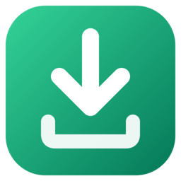
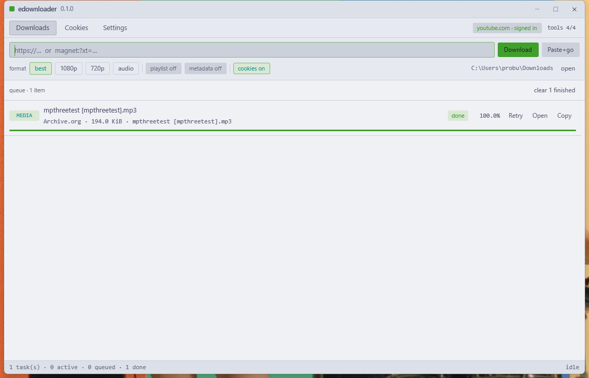
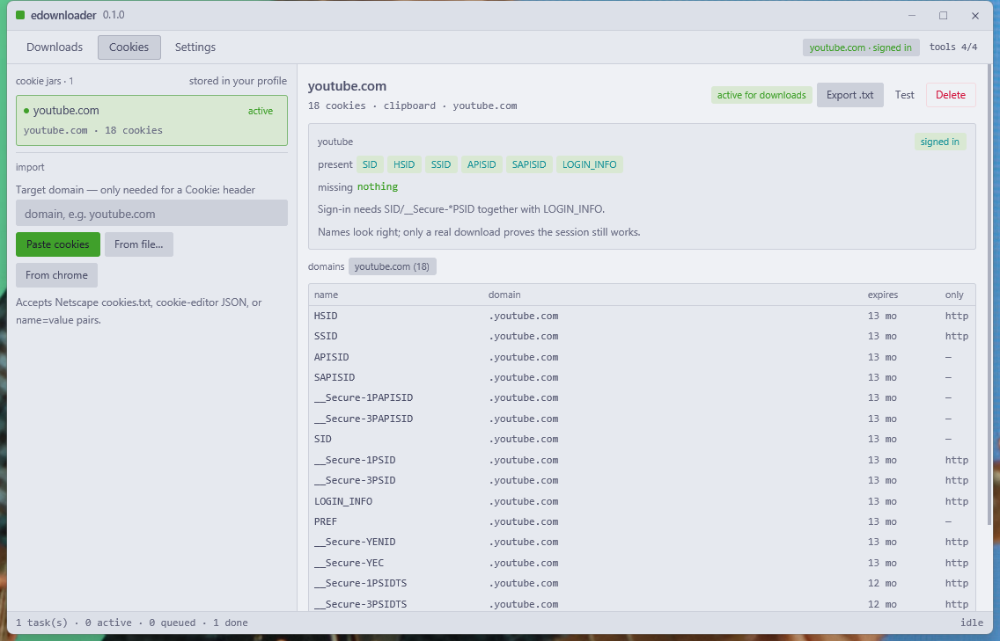
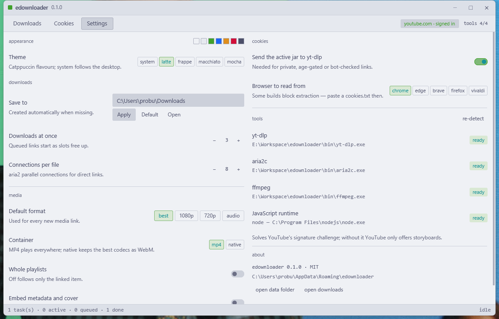
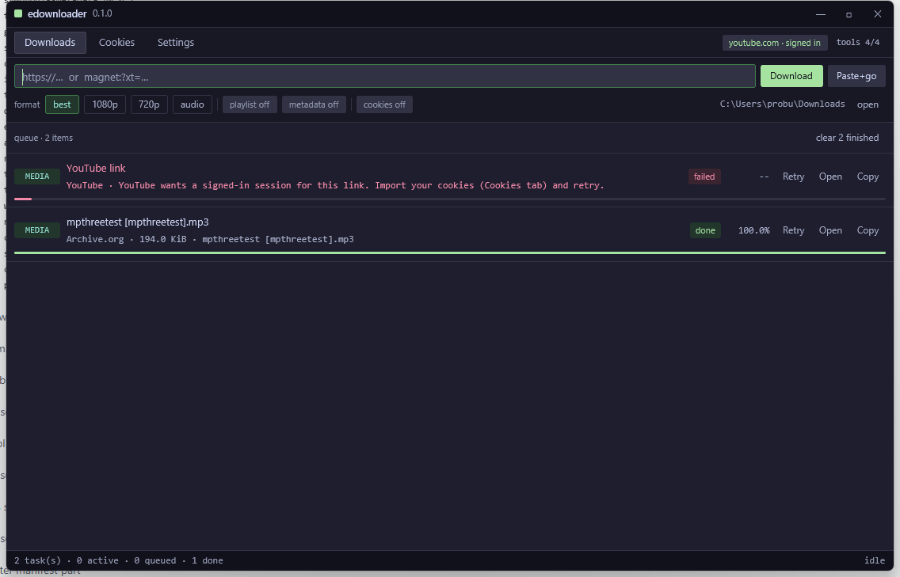

<!-- markdownlint-disable MD033 MD041 -->
<p align="center">
  
</p>

<h1 align="center">edownloader</h1>

<p align="center">
  <strong>One field. All your downloads.</strong>
  <br />
  A small, fast downloader for Windows: videos, music, direct files and magnets, from one field.
</p>

<p align="center">
  <a href="https://github.com/InstaZDLL/edownloader/actions/workflows/ci.yml"></a>
  
  
  
  
  
</p>

<p align="center">
  YouTube, Vimeo, Twitch, SoundCloud and 1,800 other sites, plain file links, magnets: drop it in, edownloader picks the right engine,
  shows real progress and puts the file in your Downloads folder. No ads, no account, no browser extension, nothing running in the background.
  <br />
  <strong>Paste it, press Enter, it's downloading.</strong>
</p>

<p align="center">
  <a href="https://github.com/InstaZDLL/edownloader/releases/latest"></a>
</p>

<p align="center">
  <a href="#install"><b>Install</b></a>
  &nbsp;·&nbsp;
  <a href="#why-edownloader"><b>Why</b></a>
  &nbsp;·&nbsp;
  <a href="#features"><b>Features</b></a>
  &nbsp;·&nbsp;
  <a href="#youtube-and-cookies"><b>YouTube &amp; cookies</b></a>
  &nbsp;·&nbsp;
  <a href="#faq"><b>FAQ</b></a>
  &nbsp;·&nbsp;
  <a href="#build-from-source"><b>Build</b></a>
</p>

<p align="center">
  
</p>

---

## Install

1. Download **`edownloader_<version>_x64-setup.exe`** from the [latest release](https://github.com/InstaZDLL/edownloader/releases/latest).
2. Run it. It installs for your user only: no administrator rights, nothing system-wide.
3. On first launch, click **Install** in the yellow banner. edownloader fetches the tools it drives — yt-dlp, aria2, ffmpeg and Deno — from their official releases and checks each one against its published checksum.

That's it. Paste a link and press <kbd>Enter</kbd>.

> **"Windows protected your PC"?** The installer is signed with a self-signed certificate, so SmartScreen does not know the publisher yet. Click **More info › Run anyway**. You can compare the file with `SHA256SUMS.txt` on the release page.

From then on edownloader keeps itself up to date: new versions download in the background, are verified against the release key, and install when you close the app.

## Why edownloader

<table>
  <tr>
    <td>🎯&nbsp;<b>One field for everything</b></td>
    <td>No "video mode" or "file mode" to choose. The link is recognised and sent to the right engine: yt-dlp for media sites, aria2 for files and magnets.</td>
  </tr>
  <tr>
    <td>⚡&nbsp;<b>Fast where it counts</b></td>
    <td>Up to 16 connections per file, several downloads at once, pause and resume that survive a dropped connection. A native app that opens instantly.</td>
  </tr>
  <tr>
    <td>🔐&nbsp;<b>YouTube that just works</b></td>
    <td>"Sign in to confirm you're not a bot"? Import your cookies once — paste, file, or straight from your browser — and edownloader tells you whether they hold a real sign-in.</td>
  </tr>
  <tr>
    <td>🧰&nbsp;<b>Zero setup</b></td>
    <td>No <code>PATH</code> to edit, no command line. The tools install in one click and yt-dlp refreshes from Settings the day a site changes.</td>
  </tr>
  <tr>
    <td>🧾&nbsp;<b>Errors you can act on</b></td>
    <td>Instead of a wall of yt-dlp output, you get what went wrong and what to do about it.</td>
  </tr>
</table>

## Features

### ⬇️ Downloads

- **Media from 1,800+ sites** through yt-dlp: titles, best format, video and audio merged, optional metadata and cover art embedded.
- **Format presets**: `best`, `1080p`, `720p`, `audio` (keeps the original codec, no lossy re-encode), and whole playlists with one toggle.
- **MP4 that plays everywhere**, up to 4K (AV1), or `native` to keep the best codecs as WebM. Resolutions above 1080p still come out with sound.
- **Direct links and magnets** through aria2: multi-connection, resumable, BitTorrent included.
- **A real queue**: a cap on simultaneous downloads, the rest start as slots free up. Pause, resume, retry, cancel, open the folder.
- **Exact progress**: bytes, speed, ETA and connections read from the engines themselves, not guessed from a log.

### 🍪 Cookies

- **Three ways in**: paste a `cookies.txt`, a cookie-editor JSON export or a raw `Cookie:` header; pick a file; or read Chrome, Edge, Brave, Firefox or Vivaldi directly.
- **Named jars**, one active at a time, with a YouTube verdict: *signed in*, *incomplete*, expired entries, covered domains. Cookie values are never shown on screen.

<p align="center">
  
</p>

### 🔄 Always current

- **App updates** download in the background, are checked against a signing key compiled into the app, and install when you close it — or right away with **Restart to update**.
- **Tool updates**: one click on *update yt-dlp* in Settings fetches the latest release, which is usually all it takes when a site starts failing.
- Two update hosts (GitHub and a mirror), so updates keep flowing even if one goes away.

### 🎨 Comfortable

- **Catppuccin** Latte, Frappé, Macchiato and Mocha, or follow Windows; every flavour is tested for readable contrast.
- **Keyboard first** (below), a compact window, monospace figures, nothing that isn't used.

<p align="center">
  
</p>

## YouTube and cookies

YouTube answers most logged-out downloaders with *"Sign in to confirm you're not a bot"*. edownloader recognises that exact failure and tells you what to do:

<p align="center">
  
</p>

1. Sign in to YouTube in your browser.
2. In edownloader, open **Cookies** and choose **From browser** (or export `cookies.txt` with an extension and **Paste** it).
3. Check that the jar says **signed in**, and download again.

Some Chromium builds lock their cookie store with app-bound encryption that no tool can read; edownloader says so and points you to the paste route.

YouTube also needs a JavaScript runtime to unlock its formats: Deno is installed with the other tools, and Node, Bun or QuickJS are picked up if you already have one.

## Keyboard

| Keys | Action |
| --- | --- |
| <kbd>Enter</kbd> | download the link in the field |
| <kbd>Ctrl</kbd>+<kbd>V</kbd>, then <kbd>Enter</kbd> / **Paste+go** | paste and start |
| <kbd>Ctrl</kbd>+<kbd>L</kbd> | jump to the link field |
| <kbd>Ctrl</kbd>+<kbd>O</kbd> | open the download folder |
| <kbd>Ctrl</kbd>+<kbd>1</kbd> / <kbd>2</kbd> / <kbd>3</kbd> | Downloads / Cookies / Settings |
| <kbd>Ctrl</kbd>+<kbd>Tab</kbd> | next tab |
| <kbd>Esc</kbd> | dismiss the message |

## FAQ

<details>
<summary><b>Why aren't yt-dlp and ffmpeg inside the installer?</b></summary>

They are large (ffmpeg alone is 200 MB), they come from other projects, and yt-dlp has to follow site changes far more often than edownloader does. Keeping them separate means a small installer, tools straight from their authors, and a one-click yt-dlp refresh without waiting for an edownloader release. They are installed in `%LOCALAPPDATA%\edownloader\tools`; if you already have them on `PATH`, edownloader uses yours.

</details>

<details>
<summary><b>Is it safe?</b></summary>

The source is right here. The installer is Authenticode-signed (self-signed, hence the SmartScreen prompt) and published with its SHA-256. Updates are only installed if they carry a valid signature from the project's release key. Tools are downloaded over HTTPS from their official GitHub releases and checked against the checksums those projects publish. edownloader has no telemetry and talks to no server of its own.

</details>

<details>
<summary><b>A site that used to work now fails.</b></summary>

Open **Settings › Tools** and click **update yt-dlp**. Sites change their pages regularly and yt-dlp follows within days. If it is a YouTube link, check that your cookie jar still says *signed in*.

</details>

<details>
<summary><b>Where do my files go? Where are my settings?</b></summary>

Downloads go to your `Downloads` folder (change it in Settings). Settings and cookie jars live in `%APPDATA%\edownloader`; tools and pending updates in `%LOCALAPPDATA%\edownloader`. Uninstalling from Windows Settings removes the app.

</details>

<details>
<summary><b>Can I use it without installing?</b></summary>

Yes: build it (below) and run `edownloader.exe` from anywhere. A copy that wasn't installed by the installer still tells you when a new version is out, but does not replace itself.

</details>

<details>
<summary><b>Is downloading from YouTube allowed?</b></summary>

Download only what you have the right to: your own uploads, freely licensed content, or what the site's terms and your local law allow. edownloader is a tool; how it is used is up to you.

</details>

## Known limits

- Windows only for now.
- No built-in browser for signing in: sessions come from your browser's cookies.
- Magnets download through aria2; `.torrent` files and seeding are not managed.
- The queue lives for the session; it is not saved on exit.

## Build from source

Rust 1.100 (pinned in `rust-toolchain.toml`) and the MSVC build tools.

```powershell
git clone https://github.com/InstaZDLL/edownloader
cd edownloader
cargo run --release
```

For development, put `yt-dlp.exe`, `aria2c.exe`, `ffmpeg.exe` in a `bin/` folder next to `Cargo.toml` (ignored by git), or let the app install them. Then:

```powershell
cargo test
cargo clippy --all-targets -- -D warnings
```

How it is put together: [docs/ARCHITECTURE.md](docs/ARCHITECTURE.md). How a release is cut, signed and mirrored: [docs/RELEASING.md](docs/RELEASING.md).

## Credits

edownloader stands on [yt-dlp](https://github.com/yt-dlp/yt-dlp), [aria2](https://github.com/aria2/aria2), [FFmpeg](https://ffmpeg.org) (builds by [yt-dlp/FFmpeg-Builds](https://github.com/yt-dlp/FFmpeg-Builds)), [Deno](https://deno.com), [GPUI](https://www.gpui.rs) and the [Catppuccin](https://catppuccin.com) palettes. Those tools are downloaded from their authors and keep their own licenses.

## License

[MIT](LICENSE).
