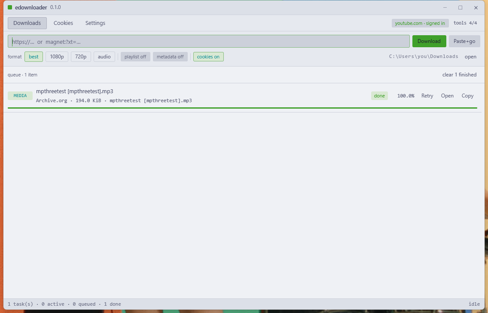

  

# edownloader 0.1.0 — first release

**One field. All your downloads.** Paste a YouTube video, a SoundCloud track, a file link or a magnet: edownloader picks the right engine, shows real progress and puts the file in your Downloads folder.

  

## Highlights

- 🎯 **One field for everything.** Pages go to yt-dlp and its extractors for 1,800+ sites, files and magnets go to aria2, and a page yt-dlp cannot read is fetched as a file. Nothing to choose by hand.
- 🧰 **Set up in one click.** On first launch, edownloader offers to install yt-dlp, aria2, ffmpeg and Deno from their official releases. Published checksums are verified where available; aria2 1.37.0 is pinned to its official GitHub release. No `PATH` to edit, no command line.
- 🔐 **YouTube that works signed in.** Import your cookies by pasting them, from a file, or straight from Chrome, Edge, Brave, Firefox or Vivaldi. Each jar tells you whether it looks signed in to YouTube, and the *"Sign in to confirm you're not a bot"* error tells you what to do instead of dumping yt-dlp's output.
- 🎬 **MP4-first output for broad compatibility**, up to 4K, or `native` to keep the best codecs as WebM. `best`, `1080p`, `720p` and `audio` presets; audio keeps its original codec, with no lossy re-encode.
- ⚡ **Fast direct downloads.** Up to 16 connections per file, a queue with a cap on simultaneous downloads, pause and resume.
- 🔄 **Updates itself.** From this version on, new releases download in the background, are checked against the release key built into the app, and install when you close it, or right away with **Restart to update**.

Also included: whole playlists in one toggle · metadata and cover embedding · exact progress, speed and ETA · one-click *update yt-dlp* in Settings · Catppuccin Latte, Frappé, Macchiato and Mocha, or follow Windows · keyboard shortcuts.

## Install

Download **`edownloader_0.1.0_x64-setup.exe`** below and run it. edownloader installs for your user only, with no administrator rights required.

On first launch, click **Install** in the yellow banner to fetch the tools (about 270 MB, mostly ffmpeg). If you already have yt-dlp, aria2, ffmpeg or a JavaScript runtime (Deno, Node, Bun) on your `PATH`, edownloader uses yours and only offers what is missing.

> [!NOTE]
> The installer and `edownloader.exe` are signed with a self-signed certificate. Windows does not recognise it as a trusted publisher yet, so SmartScreen may show *"Windows protected your PC"* on first launch. Click **More info → Run anyway**.

`SHA256SUMS.txt` contains the installer checksum. `latest.json` is what the updater reads: the installer's address and its signature.

## Requirements

- **Windows 10 or 11, 64-bit.**
- An internet connection on first launch to install the tools.
- For signed-in YouTube downloads: a browser where you are signed in to YouTube, or a `cookies.txt` export.

## Known limitations

- Windows only.
- Some Chromium-based browsers lock their cookie store with app-bound encryption that no tool can read. edownloader says so; export `cookies.txt` with a browser extension and paste it instead.
- aria2 1.37.0 publishes no checksum, so it is downloaded over HTTPS from its official GitHub release without one.
- Magnets download through aria2; `.torrent` files and seeding are not managed.
- The download queue is not saved when you close the app.

**Full changelog:** https://github.com/InstaZDLL/edownloader/commits/v0.1.0

---

edownloader drives [yt-dlp](https://github.com/yt-dlp/yt-dlp), [aria2](https://github.com/aria2/aria2), [FFmpeg](https://ffmpeg.org) and [Deno](https://deno.com), downloaded from their authors under their own licenses. Built in Rust with [GPUI](https://www.gpui.rs).
